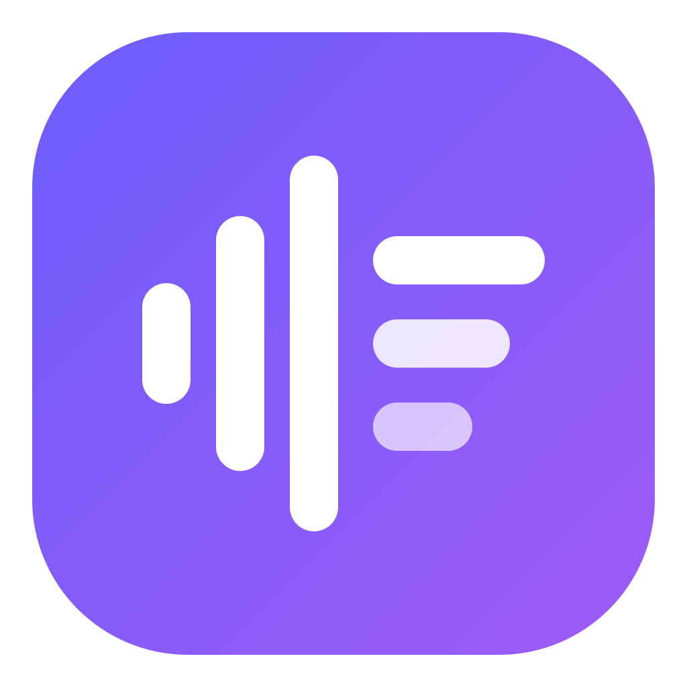
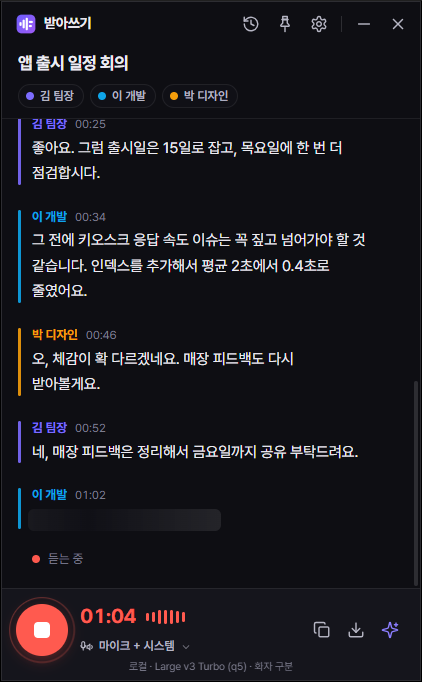
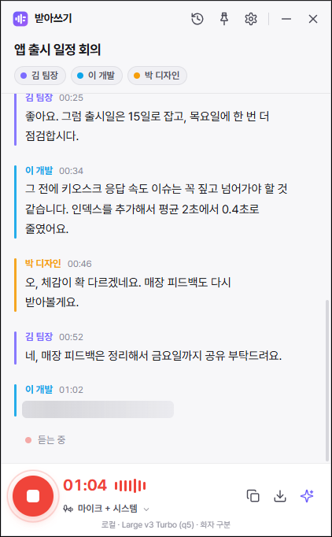

<div align="center">



# 받아쓰기

**말하는 사람을 구분해 실시간으로 받아 적는, 가볍고 빠른 Windows 회의 전사 앱**

러스트(Rust)로 만들어 가볍고, 로컬 AI(whisper.cpp)로 인터넷 없이도 동작합니다.<br />
트레이에서 한 번 누르면 시작 — 회의에만 집중하세요.

[](https://github.com/jeiel85/badasugi/releases/latest)
[](LICENSE)


[**🌐 홈페이지**](https://jeiel85.github.io/badasugi/) · [**⬇️ 내려받기**](https://github.com/jeiel85/badasugi/releases/latest) · [버그 제보](https://github.com/jeiel85/badasugi/issues)


&nbsp;&nbsp;


<sub>화면 예시 (데모 데이터)</sub>

</div>

---

## ✨ 특징

| | |
|---|---|
| 🎙️ **화자 자동 구분** | 발화마다 목소리 임베딩(3D-Speaker CAM++)을 뽑아 실시간으로 사람을 나눕니다. 쉼 없이 말을 이어받아도 **문장 안의 화자 전환점**을 찾아 쪼갭니다. 이름을 눌러 "화자 1" → "김 팀장"으로 바로 변경. |
| 🇰🇷 **한국어에 강한 인식** | Whisper large-v3 turbo. **용어집**에 회사·제품명을 넣으면 고유명사 인식률이 올라갑니다. "시청해 주셔서 감사합니다" 같은 Whisper 특유의 환각 문구와 반복 루프를 걸러냅니다. |
| 🔒 **로컬 또는 API** | 민감한 회의는 PC 안에서만(whisper.cpp). 빠르게 필요하면 **Groq · OpenAI · OpenAI 호환 서버**. 화자 구분은 어떤 엔진이든 항상 로컬에서 처리합니다. |
| ⚡ **실시간** | Silero VAD로 말이 멈추는 순간 발화를 잘라 바로 인식합니다. 짧은 발화는 인코더 창을 줄여 3~5배 빠르게. |
| 🖱️ **트레이 원클릭** | 창을 닫아도 트레이에 상주. 전역 단축키 **`Ctrl+Alt+R`** 로 어디서든 녹음 시작/중지. "항상 위" 고정. |
| 💻 **온라인 회의** | 마이크 + **PC 소리(WASAPI 루프백)** 동시 캡처 — Zoom · Teams · Meet 상대방 목소리까지. 가상 오디오 장치 불필요. |
| ✍️ **AI 회의록 요약** | 한 줄 요약 · 주요 논의 · 결정 사항 · 할 일(담당자/기한). 로컬 LLM(Ollama, 한국어 특화 **EXAONE 3.5**) · Claude · OpenAI · 호환 서버. |
| 💾 **자동 저장 · 내보내기** | 말하는 동안 계속 저장(앱이 꺼져도 안전). 더블클릭으로 오타 수정. Markdown · TXT · SRT 자막 · JSON. |

## ⬇️ 설치

1. [Releases](https://github.com/jeiel85/badasugi/releases/latest)에서 `Badasugi_x.y.z_x64-setup.exe` 를 내려받아 실행합니다. (관리자 권한 불필요)
2. 처음 실행하면 **모델 내려받기** 버튼이 보입니다 → 음성 인식 모델(약 574MB) + 화자 모델(28MB)을 한 번만 받으면 이후 오프라인으로 동작합니다.
   - 모델을 받기 싫다면 설정에서 **Groq / OpenAI** 를 고르고 API 키만 넣으면 바로 쓸 수 있습니다.
3. 녹음 버튼(또는 `Ctrl+Alt+R`)을 누르고 회의를 시작하세요.

> **"Windows의 PC 보호" 경고가 뜨면** — 코드 서명 인증서가 없는 개인 오픈소스라 SmartScreen이 경고합니다. **추가 정보 → 실행** 을 누르세요. 걱정되면 [직접 빌드](#-직접-빌드하기)할 수 있습니다.

**요구 사항**: Windows 10/11 64비트, AVX2 지원 CPU(2013년 이후 대부분), WebView2(Windows 11 기본 포함). GPU 불필요.

## 🚀 사용법

| 하고 싶은 것 | 방법 |
|---|---|
| 녹음 시작/중지 | 녹음 버튼 · `Ctrl+Alt+R` · 트레이 아이콘 우클릭 |
| 입력 소리 바꾸기 | 하단 **마이크 ▾** → 마이크 / 시스템 소리 / 마이크 + 시스템 |
| 화자 이름 바꾸기 | 상단 화자 칩이나 본문의 화자 이름 클릭 |
| 잘못 들린 단어 고치기 | 문장을 **더블클릭** → 수정 → Enter |
| 회의 요약 | 하단 ✨ 버튼 (설정 › AI 요약에서 제공자 선택) |
| 내보내기 | 하단 ⬇ 버튼 → Markdown / TXT / SRT / JSON |
| 지난 회의 보기 | 상단 🕘 회의 기록 |
| 회의 화면 옆에 띄워두기 | 상단 📌 항상 위 |

### 명령줄 제어 (Stream Deck · 배치 파일 · 바로 가기)

이미 실행 중인 받아쓰기에 명령이 전달됩니다.

```bat
badasugi.exe --toggle   :: 녹음 시작/중지
badasugi.exe --start
badasugi.exe --stop
```

### 화자 구분이 어긋날 때

- 한 사람이 여러 명으로 나뉘면 → 설정 › 화자 구분 › **구분 민감도**를 왼쪽(화자를 적게)으로
- 여러 사람이 한 명으로 합쳐지면 → 오른쪽(화자를 많이)으로
- 참석 인원을 알면 **최대 화자 수**를 지정하는 게 가장 정확합니다.

## ⚙️ 엔진 고르기

| | 로컬 (whisper.cpp) | Groq | OpenAI |
|---|---|---|---|
| 모델 | large-v3-turbo (q5) 등 | whisper-large-v3-turbo | gpt-4o-transcribe |
| 속도 | PC 사양에 따라 | 매우 빠름 | 빠름 |
| 한국어 정확도 | 높음 | 높음 | 매우 높음 |
| 비용 | 무료 | 사용량 과금 (저렴) | 사용량 과금 |
| 회의 내용 | **PC 밖으로 안 나감** | Groq 서버로 전송 | OpenAI 서버로 전송 |

- **사용자 지정**: OpenAI 호환 `/audio/transcriptions` 서버(faster-whisper-server, LocalAI, 사내 서버 등)를 연결할 수 있습니다.
- API 키는 **Windows 자격 증명 관리자**에 저장됩니다(설정 파일에 평문으로 남지 않음).
- 모델 폴더(`%LOCALAPPDATA%\com.badasugi.desktop\models`)에 `ggml-*.bin` 을 직접 넣으면 목록에 나타납니다(한국어 파인튜닝 모델 등).

### 성능 메모 (솔직하게)

로컬 엔진 속도는 CPU에 크게 좌우됩니다. 개발 PC(Intel Core 5 210H, 8코어, GPU 미사용) 측정값:

| 모델 | 8.3초 발화 처리 | 비고 |
|---|---|---|
| large-v3-turbo q5 (인코더 창 축소 적용) | 약 4.8초 | 짧은 발화는 발화당 약 5~6초 |
| large-v3-turbo q5 (기본 30초 창) | 약 25초 | ← 받아쓰기가 피하는 방식 |
| base q5 | 약 1.2초 | 빠르지만 한국어 정확도 낮음 |

말이 끊임없이 이어지는 회의에서 CPU가 느리면 인식이 조금씩 밀릴 수 있습니다(앱이 알려줍니다). 그럴 땐 **Groq API**(초 단위 응답, 저렴)나 가벼운 모델을 권장합니다. GPU 가속(Vulkan) 빌드는 아래 "직접 빌드하기"를 참고하세요.

## 📁 저장 위치

| 내용 | 위치 |
|---|---|
| 회의 기록 (`.json` + `.md`, 선택 시 `.wav`) | `문서\받아쓰기\` |
| 모델 | `%LOCALAPPDATA%\com.badasugi.desktop\models\` |
| 설정 | `%APPDATA%\com.badasugi.desktop\settings.json` |
| API 키 | Windows 자격 증명 관리자 (`badasugi`) |

## 🧠 작동 방식

```
 마이크 ─┐                    ┌──────────── DSP 스레드 ────────────┐
         ├─ cpal(WASAPI) ──▶ │ 16kHz 리샘플 → 믹스 → Silero VAD v6 │
 PC 소리 ┘   (루프백)          └───────────────┬────────────────────┘
                                              │ 발화 단위 (말이 멈추면 즉시)
                                              ▼
                              ┌──────── 디스패처 ────────┐
                              │ 발화 내 화자 전환 감지     │  3D-Speaker CAM++ (ONNX)
                              │ 화자 임베딩 → 온라인 클러스터링 │  + Kaldi fbank (직접 구현)
                              └────────────┬────────────┘
                                           ▼
                         ┌──── ASR 워커 (로컬 1개 / API 3개 병렬) ────┐
                         │ whisper.cpp (인코더 창 = 발화 길이 + 2초)    │
                         │ 또는 OpenAI 호환 API                        │
                         │ → 환각·반복 제거 → 화면 · 자동 저장           │
                         └──────────────────────────────────────────┘
```

- **발화 분할**: 32ms 단위 음성 확률, 0.5초 침묵이면 발화 종료, 15초를 넘으면 숨 쉬는 지점(음성 확률 최저점)에서 자름
- **화자 전환 감지**: 1.5초 창의 임베딩 유사도 행렬에서, 경계 양쪽의 교차 유사도가 내부 유사도보다 뚜렷이 낮은 지점을 이진 분할로 찾음
- **짧은 발화**("네", "자") 는 임베딩이 불안정하므로 새 화자를 만들지 않고, 회의 첫마디로 생긴 임시 화자는 다음 긴 발화가 확정
- **인코더 창 축소**: whisper는 항상 30초 창을 계산하지만 실제 발화 길이 + 2초(최소 7.7초)로 줄여 3~5배 가속. 반복 루프가 감지되면 전체 창으로 재인식

### 검증

| 테스트 | 결과 |
|---|---|
| 3명이 번갈아 말함 (쉼 있음, 48초) | 발화 13/13 화자 정확 |
| 3명이 **쉼 없이** 이어 말함 (41초) | 13/13 정확 — 문장 안 전환점 3곳 모두 분리 |
| 한국어 1명 + 다른 화자 2명 혼합 (58초) | 16/16 정확 |
| 1명 회의 (40초) | 오분할 0건 |
| 한국어 회의 TTS 10문장 (turbo) | 10/10 문장 정확 인식 |

`cargo run --release --example transcribe -- <파일.wav> --model <ggml.bin> --speaker <onnx>` 로 직접 재현할 수 있습니다.

## 🛠 직접 빌드하기

**준비물**: [Rust](https://rustup.rs) (stable), Visual Studio 2022 Build Tools (C++ 데스크톱 개발 + **C++ CMake 도구**), [Tauri CLI](https://tauri.app) (`cargo install tauri-cli --version "^2"`)

```powershell
# VS 에 포함된 cmake 를 PATH 에 추가 (경로는 에디션에 맞게)
$env:PATH = "C:\Program Files\Microsoft Visual Studio\2022\Community\Common7\IDE\CommonExtensions\Microsoft\CMake\CMake\bin;$env:PATH"

cargo build --release -p badasugi          # 실행 파일: target\release\badasugi.exe
cd src-tauri; cargo tauri build            # 설치 파일: target\release\bundle\nsis\
```

- `.cargo/config.toml` 이 whisper.cpp 를 **AVX2 기준 + /O2 최적화**로 빌드하도록 설정합니다.
  (cmake 크레이트가 Visual Studio 생성기에서 Release 최적화 플래그를 지우는 문제가 있어, 이 설정이 없으면 20배 이상 느려집니다.)
- GPU 가속: [Vulkan SDK](https://vulkan.lunarg.com/) 설치 후 `cargo build --release -p badasugi --features vulkan`

### 프로젝트 구조

```
crates/badasugi-core/   코어 (UI 독립) — 오디오·VAD·fbank·화자·ASR·파이프라인
  examples/             transcribe(파일 전사) · bench(whisper 속도) · turns(화자 전환 진단) · live(장치 점검)
src-tauri/              Tauri 앱 — 트레이·단축키·설정·기록·요약
ui/                     프런트엔드 (프레임워크 없는 HTML/CSS/JS)
docs/                   홈페이지 (GitHub Pages)
```

개발용 환경 변수: `BADASUGI_TEST_WAV=<wav>` (장치 대신 WAV를 실시간으로 흘려 넣기) · `BADASUGI_DEMO=1` (데모 화면) · `BADASUGI_THREADS` · `BADASUGI_FULL_CTX=1` · `BADASUGI_WHISPER_DEBUG=1`

## 🗺 로드맵

- [ ] 녹음 파일(mp3·m4a·wav) 불러와 전사
- [ ] 회의 후 전체 화자 재정리(오프라인 재클러스터링)
- [ ] 한국어 특화 STT API(리턴제로 · CLOVA Speech) 연동
- [ ] 화자 목소리 등록(다음 회의에서 이름 자동 지정)
- [ ] macOS 지원

## 🙏 감사의 말

받아쓰기는 훌륭한 오픈소스 위에 서 있습니다.

| 구성 요소 | 라이선스 |
|---|---|
| [whisper.cpp](https://github.com/ggml-org/whisper.cpp) · [whisper-rs](https://codeberg.org/tazz4843/whisper-rs) · OpenAI Whisper 모델 | MIT |
| [Silero VAD](https://github.com/snakers4/silero-vad) (앱에 포함) | MIT |
| [3D-Speaker](https://github.com/modelscope/3D-Speaker) CAM++ 화자 모델 ([sherpa-onnx](https://github.com/k2-fsa/sherpa-onnx) 배포본) | Apache-2.0 |
| [ONNX Runtime](https://onnxruntime.ai) · [ort](https://ort.pyke.io) | MIT · MIT/Apache-2.0 |
| [Tauri](https://tauri.app) · [cpal](https://github.com/RustAudio/cpal) | MIT/Apache-2.0 |
| [Pretendard](https://github.com/orioncactus/pretendard) 글꼴 (앱에 포함) | SIL OFL 1.1 |

## 📄 라이선스

[MIT](LICENSE) © 2026 받아쓰기 contributors
