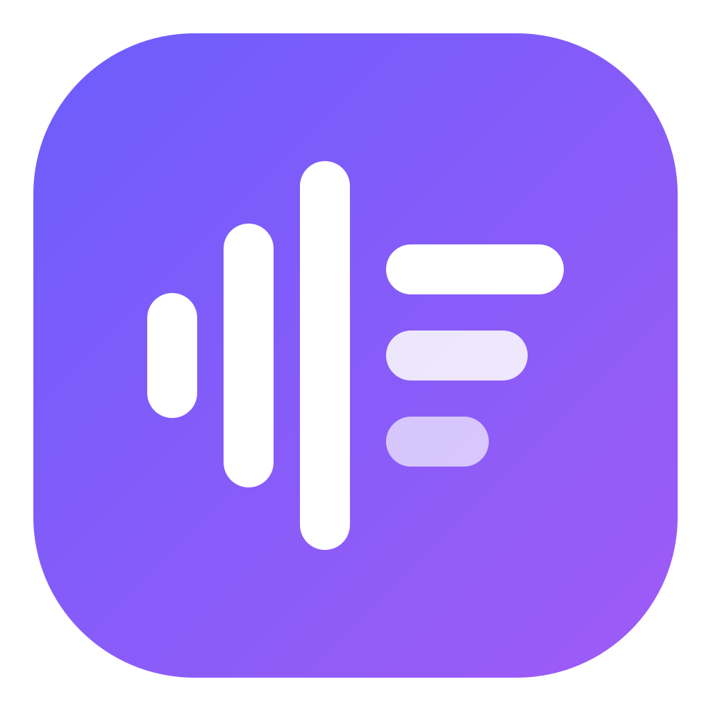
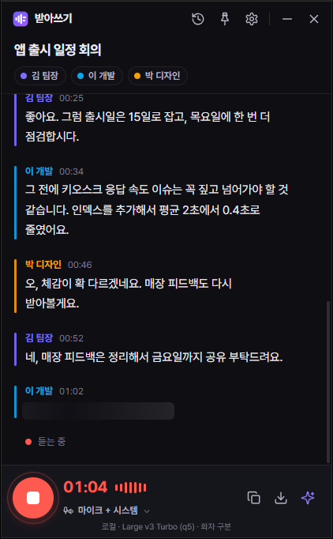
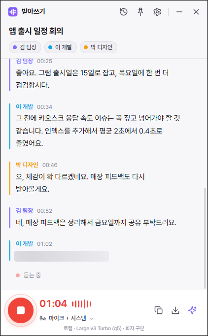
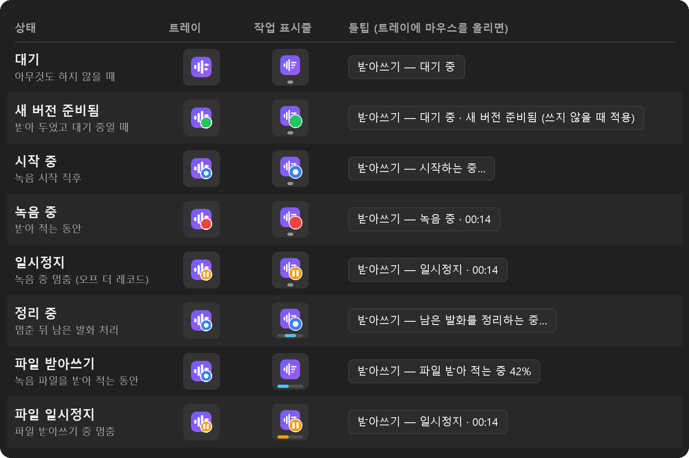

<div align="center">



# 받아쓰기

**말하는 사람을 구분해 실시간으로 받아 적는, 가볍고 빠른 Windows 회의 전사 앱**

러스트(Rust)로 만들어 가볍고, 로컬 AI(whisper.cpp)로 인터넷 없이도 동작합니다.<br />
트레이에서 한 번 누르면 시작 — 회의에만 집중하세요.

[](https://github.com/jeiel85/badasugi/releases/latest)
[](LICENSE)


[**🌐 홈페이지**](https://jeiel85.github.io/badasugi/) · [**⬇️ 내려받기**](https://github.com/jeiel85/badasugi/releases/latest) · [버그 제보](https://github.com/jeiel85/badasugi/issues)


&nbsp;&nbsp;


<sub>화면 예시 (데모 데이터)</sub>

</div>

---

## ✨ 특징

| | |
|---|---|
| 🎙️ **화자 자동 구분** | 발화마다 목소리 임베딩(3D-Speaker CAM++)을 뽑아 실시간으로 사람을 나눕니다. 쉼 없이 말을 이어받아도 **문장 안의 화자 전환점**을 찾아 쪼갭니다. 녹음이 끝나면 **회의 전체를 다시 듣고 화자를 한 번 더 정리**합니다(둘로 나뉜 같은 사람 합치기 · 초반에 잘못 붙은 문장 옮기기). 이름을 눌러 "화자 1" → "김 팀장"으로 바로 변경하고, 잘못 나뉜 화자는 **합치기 · 문단별로 화자 바꾸기**로 정리. |
| 🧠 **목소리 기억** | 한 번 이름을 붙인 사람은 **다음 회의에서 목소리로 알아보고 이름을 자동으로** 붙입니다(녹음 중에 바로). 목소리 특징값(숫자)만 이 PC에 두고, 설정에서 언제든 잊게 할 수 있어요. |
| 🇰🇷 **한국어에 강한 인식** | Whisper large-v3 turbo · OpenAI gpt-transcribe. **용어집**에 회사·제품명을 넣으면 고유명사 인식률이 올라갑니다. OpenAI 엔진은 바로 앞에서 받아 적은 문장을 함께 넘겨 문장부호·띄어쓰기를 앞 문장과 맞춥니다. "시청해 주셔서 감사합니다" 같은 Whisper 특유의 환각 문구와 반복 루프를 걸러냅니다. |
| 🔒 **로컬 또는 API** | 민감한 회의는 PC 안에서만(whisper.cpp). 빠르게 필요하면 **Groq · OpenAI · OpenAI 호환 서버**. 화자 구분은 어떤 엔진이든 항상 로컬에서 처리합니다. 인터넷이 잠깐 끊기거나 요청 한도에 걸려 받아 적지 못한 문장은 들고 있다가 **녹음을 멈출 때 다시 받아 적습니다**. |
| ⚡ **실시간** | Silero VAD로 말이 멈추는 순간 발화를 잘라 바로 인식합니다. 짧은 발화는 인코더 창을 줄여 3~5배 빠르게. **말하는 동안 미리 보기** — 말이 끝나기 전에도 1.5초마다 지금까지 들린 말을 흐린 글씨로 먼저 보여 주고, 말이 끝나면 확정 문장으로 바꿔요(로컬 엔진은 기본으로 켜지고, 확정 문장이 밀리면 저절로 꺼져요). |
| 🖱️ **트레이 원클릭 · 미니 창** | 창을 닫아도 트레이에 상주. 전역 단축키 **`Ctrl+Alt+R`** 로 어디서든 녹음 시작/중지. **미니 창**은 녹음 버튼과 방금 받아 적은 한 줄만 작업 표시줄 시계 위에 띄워 둡니다. 창을 끌면 화면 가장자리·작업 표시줄에 **자석처럼** 붙어요. |
| 💻 **온라인 회의** | 마이크 + **PC 소리(WASAPI 루프백)** 동시 캡처 — Zoom · Teams · Meet 상대방 목소리까지. 가상 오디오 장치 불필요. **회의 시작 알림**을 켜 두면 회의 앱이 마이크를 쓰기 시작할 때 시계 위에서 "받아쓸까요?" 를 묻고, 회의가 끝나면 "멈출까요?" 를 물어요(녹음을 저절로 시작하지는 않아요). **Outlook 일정에서 가져오기**를 켜면 지금 일정의 제목이 회의 제목이 되고 참석자를 화자 이름으로 고를 수 있어요. |
| ✍️ **AI 회의록 요약** | 한 줄 요약 · 주요 논의 · 결정 사항 · 할 일(기한) + 회의 제목 자동 작성. 요점마다 **근거 발언의 시각**(`00:46`)이 붙어, 누르면 녹취록 그 문장으로 가서 원문을 바로 확인해요. **회의 종류별 요약 틀** — 일반 회의 · 1:1 면담 · 면접/인터뷰 · 강의/세미나 · 고객 미팅 · 아이디어 회의, 섹션을 직접 정한 **내 틀**도. **Groq · Gemini(무료 등급)** · Claude · OpenAI · 로컬 LLM(Ollama, 한국어 특화 **EXAONE 3.5**) · OpenAI 호환 서버. |
| 💬 **회의에 묻기** | "VPN 비용 얼마라고 했지?" "이도현 매니저 의견만 정리해 줘" — 요약에 쓰는 AI 에게 이 회의를 **물어보면** 녹취록 · 요약 · 메모를 보고 답해요. 답에는 근거가 된 발언의 **시각**이 붙고, 누르면 녹취록 그 문장으로 갑니다. 앞선 질문을 이어서 물을 수 있고(“그건 누가 하기로 했어?”), **녹음 중에도** 지금까지의 내용으로 답해요. 늦게 들어왔거나 잠깐 자리를 비웠으면 **지금까지 따라잡기** — **지난 10분 정리** 한 번으로 지금 무슨 얘기 중인지 · 그동안의 흐름 · 정해진 것을 받아요. 묻고 답한 것은 기록에 남아 Markdown 회의록 · 검색에 함께 들어갑니다. 회의 기록의 **모든 회의에 묻기**로 여러 회의를 가로질러 물을 수도 있어요("지난달 VPN 비용 얘기 어디서 했지?" — 답의 근거를 누르면 그 회의의 그 문장으로). |
| 🎧 **다시 듣기 · 문장 눌러 듣기** | 회의 녹음을 앱 안에서 바로 재생(속도 0.75~2배) — **녹음 중에도** 앞부분을 다시 들을 수 있어요. 재생 막대는 하단 녹음 버튼 바로 옆에 있고, 막대를 옮기면 녹취록에서 그 문장을, 문장을 누르면 막대가 그 자리로 갑니다. 이어 들으면 지금 문장을 따라가며 표시합니다. |
| 🗣 **어디서나 말로 입력** | 설정에서 켜면 단축키(`Ctrl+Alt+Space`)를 누른 채 말하고 떼면 지금 커서가 있는 곳(메일 · 메신저 · 문서)에 글자가 들어가요. 회의 받아쓰기와 같은 엔진 · 용어집으로, 군말(음 · 어)은 빼고 문장부호를 붙여요. |
| 📂 **녹음 파일 받아쓰기** | 휴대폰·Zoom 녹음(mp3 · m4a · mp4 · wav · flac · ogg · opus)을 창에 **끌어다 놓으면** 화자를 나눠 받아 적습니다. 녹음이 쌓이는 폴더(OneDrive 등)를 정해 두면 **새 파일을 알아서 받아 적고 요약까지** 해요(녹음 폴더 지켜보기). |
| 🔒 **개인정보 가리기 · 녹음 보관 기간** | 설정 › 일반 › **개인정보** — 전화번호 · 주민등록번호 · 카드번호 · 계좌번호 · 이메일처럼 보이는 숫자를 `[전화번호]` 같은 글로 가려서 **AI 로 보내거나**(요약 · 묻기 · 따라잡기 · 번역) **내보내요**(Markdown · Word · PDF · 텍스트 · 자막 · 복사 · 보내기). PC 안에서 규칙으로 가리고 기록의 원문은 그대로라, 답의 근거 시각은 원문 문장으로 이어져요. **녹음 파일 보관 기간**(7일 · 30일 · 90일 · 1년)을 정하면 지난 회의의 녹음 파일만 지우고 녹취록 · 요약 · 메모는 남겨요. |
| 🌐 **번역** | 영어 · 일본어 회의를 한국어로, 또는 한국어 회의를 영어 · 일본어 · 중국어로 — 요약에 쓰는 AI 로 문장마다 번역해 **문단 아래에** 보여 줘요. 지난 회의는 하단 **번역** 단추로, **녹음 중 실시간 번역**을 켜 두면 문장이 확정되는 대로 번역해요. 원문은 그대로 두고 번역은 따로 저장되고, 문장을 고치면 그 문장만 다시 번역해요. 내보낼 때 녹취록을 원문 · 번역 · 둘 다로 골라요. Ollama 를 쓰면 PC 안에서 끝나요. |
| ⭐ **중요 표시** | 회의 중 "지금 이거 중요해" 싶으면 **`Ctrl+Alt+B`** — 다른 창을 보고 있어도(전역 단축키), 미니 창의 ⭐ 로도 돼요. 그때 말하던 문장에 ⭐ 가 붙고 메모에 `[12:34] ⭐` 줄로 남으며, **AI 요약이 그 부분을 꼭 다루고 그 요점에도 ⭐** 를 달아요. 지난 회의는 들으면서 표시하거나 문장 도구의 ⭐ 로 붙이고 떼요. |
| 📝 **메모 · 코멘트 · 요약 고치기** | 창을 크게 띄우면 녹취록 **옆에 노트**(좁은 창은 아래) — 회의를 보면서 메모하고(⏱ 지금 시각 넣기), 문장마다 **코멘트**를 달고, AI 요약을 **직접 고칠** 수 있어요. **코멘트는 메모의 `[시각]` 줄**이에요 — 메모에 `[12:34]` 로 시작하는 줄을 쓰면 그 시각 문장에 코멘트로 붙고, 문장에서 단 코멘트도 메모에 시각 줄로 함께 적혀요(기준은 타임라인 하나). 화면이 넓으면 코멘트가 녹취록 오른쪽 여백, **그 문장 바로 옆**에 붙어요. 모두 기록에 저장되고 Markdown 회의록 · 검색에 함께 들어갑니다. |
| 💾 **자동 저장 · 찾기 · 내보내기** | 말하는 동안 계속 저장(앱이 꺼져도 안전) — 회의가 길어질수록 저장 간격을 늘려(최대 10초) 디스크·OneDrive 부담을 줄입니다. 지난 회의 **전체 검색**, 녹취록 안 `Ctrl+F` 찾기 · `Ctrl+H` **찾아 바꾸기**(되돌리기 가능). 더블클릭으로 오타 수정(비우면 삭제) — 고친 말이 회의에 더 있으면 **모두 바꿀지**, **용어집에 넣을지** 물어봐요. Markdown · **Word(.docx)** · **PDF** · TXT · SRT 자막 · JSON — Word · PDF 는 결재 · 공유용으로 요약(할 일은 표로) · 메모 · 묻고 답하기 · 발언 통계 · 녹취록 · 코멘트까지 한 문서에. |
| 🔄 **자동 업데이트** | 새 버전을 백그라운드에서 받아 두었다가, 쓰지 않을 때(트레이에 있을 때) 조용히 적용합니다. 서명(minisign)을 검증한 파일만 설치. |

## ⬇️ 설치

1. [Releases](https://github.com/jeiel85/badasugi/releases/latest)에서 `Badasugi_x.y.z_x64-setup.exe` 를 내려받아 실행합니다. (관리자 권한 불필요)
2. 처음 실행하면 **모델 내려받기** 버튼이 보입니다 → 음성 인식 모델(약 574MB) + 화자 모델(28MB)을 한 번만 받으면 이후 오프라인으로 동작합니다.
   - 모델을 받기 싫다면 설정 › 녹음에서 **Groq / OpenAI** 를 고르고 API 키만 넣으면 바로 쓸 수 있습니다.
3. 녹음 버튼(또는 `Ctrl+Alt+R`)을 누르고 회의를 시작하세요.

> **"Windows의 PC 보호" 경고가 뜨면** — 코드 서명 인증서가 없는 개인 오픈소스라 SmartScreen이 경고합니다. **추가 정보 → 실행** 을 누르세요. 걱정되면 [직접 빌드](#-직접-빌드하기)할 수 있습니다.

**요구 사항**: Windows 10/11 64비트, AVX2 지원 CPU(2013년 이후 대부분), WebView2(Windows 11 기본 포함). GPU 는 없어도 되고, 있으면(내장 그래픽 포함 · Vulkan) 로컬 엔진이 저절로 써서 몇 배 빨라져요.

## 🚀 사용법

| 하고 싶은 것 | 방법 |
|---|---|
| 녹음 시작/중지 | 녹음 버튼 · `Ctrl+Alt+R` · 트레이 아이콘 우클릭 |
| 미니 창 (작업 표시줄 시계 위) | 상단 ▣ 버튼 · 제목 줄 **더블클릭** · 트레이 메뉴 **미니 창으로** — 미니 창을 더블클릭(또는 ⤢)하면 원래 창 위치·크기로 복구 |
| 잠깐 멈추기 (오프 더 레코드) | 녹음 중 하단 ⏸ · 트레이 메뉴 **일시정지** — 녹음 중 PC가 **절전**에 들어가면(덮개 닫기 등) 자동으로 멈추고, 깨어나면 "절전으로 멈춤"으로 알려 줘요. ▶ 로 이어서 |
| 녹음 파일 받아쓰기 | 파일을 창에 끌어다 놓기 · 회의 기록 › 📄 |
| 어디서나 말로 입력 | 설정 › 일반 › **말로 입력**을 켜고, 글을 쓸 곳에 커서를 둔 채 `Ctrl+Alt+Space` 를 **누른 채 말하고 떼면** 들어가요(화면 아래 가운데 작은 알림이 듣는 중 · 받아 적는 중을 보여 줘요). **톡 누르면** 손을 떼고 말해도 되고, 다시 누르거나 말이 끝나고 2초 조용하면 넣어요. 음 · 어 같은 군말 · 되풀이는 빼고 "쉼표" · "마침표" · "물음표" · "줄 바꿈" 이라고 말하면 그 문장부호로 바꿔요. 넣는 방법은 **붙여넣기**(원래 클립보드는 되돌려 놓고 클립보드 기록에도 남기지 않아요) 또는 **한 글자씩**. **AI 로 다듬기**를 켜면 설정 › 요약의 AI 로 맞춤법 · 띄어쓰기도 다듬어요. 회의를 받아 적는 동안 마이크를 쓰고 있으면 쉬어요(내 말이 회의 기록에 섞이지 않게) |
| 휴대폰 녹음을 알아서 받아 적기 | 설정 › 일반 › **녹음 폴더 지켜보기**를 켜고 녹음이 쌓이는 폴더(OneDrive · 녹음기 동기화 폴더 등)를 골라요 → 그 폴더에 **새로 생기는** 녹음 파일을 받아 적고 요약까지 해요(요약은 끌 수 있어요). 켤 때 이미 있던 파일은 건너뛰고, 아직 동기화 · 복사 중인 파일은 다 쓸 때까지 기다려요. 녹음 중이면 끝난 뒤에 하고, 받아 적는 중에 녹음을 시작하면 녹음이 먼저예요(그 파일은 녹음을 마친 뒤 처음부터 다시). 받아 적은 파일은 기억해 두 번 하지 않아요. 하단의 **멈추기**는 받아 적은 데까지 남기고 그 파일을 다시 받아 적지 않아요 |
| 입력 소리 바꾸기 | 하단 **마이크 ▾** → 마이크 / 시스템 소리 / 마이크 + 시스템 |
| 회의가 시작되면 알림 받기 | 설정 › 일반 › **회의 시작 알림**을 켜고 지켜볼 앱(Zoom · Teams · 브라우저(Meet 등) · Webex · Slack · Discord · 카카오톡)을 골라요 → 그 앱이 마이크를 3초 넘게 쓰면 작업 표시줄 시계 위에 **"회의가 시작된 것 같아요"** 알림(지금 보던 창의 포커스는 그대로). **받아쓰기 시작**을 누르면 마이크 + 시스템 소리로 바로 받아 적고(입력을 시스템 소리로 골라 두었으면 그대로), 그 앱이 마이크를 놓으면 **"멈출까요?"** 를 물어요. 답하지 않으면 1분 뒤 저절로 닫혀요. 받아쓰기가 켜져 있어야 하니 **Windows 시작 시 실행**도 켜 두면 좋아요 |
| 회의 제목 · 참석자를 일정에서 | 설정 › 일반 › **Outlook 일정에서 제목 · 참석자 가져오기**를 켜요 → 녹음을 시작할 때 지금 시각의 일정(시작 15분 전 ~ 끝나고 5분, 하루 종일 · 취소된 일정은 빼고)이 있으면 그 제목이 회의 제목이 되고, 화자 이름을 바꿀 때 참석자 이름을 골라 넣을 수 있어요. 회의 시작 알림에도 일정 제목이 보여요. **켜져 있는 클래식 Outlook** 만 읽고(로그인 · 앱 등록 없음, 받아쓰기가 Outlook 을 띄우지 않음), 새 Outlook 만 있으면 쓸 수 없어요. Outlook 이 바깥 프로그램을 믿지 않는 상태(백신 꺼짐 · 회사 정책)면 보안 경고가 뜨지 않게 참석자는 읽지 않아요. 설정에 지금 Outlook 상태 · 지금 일정이 보여요 |
| 화자 이름 바꾸기 · 합치기 | 상단 화자 칩 클릭 → 이름 바꾸기 / 다른 화자와 합치기. 이미 만든 요약 속 "화자 2" 도 새 이름으로 바뀌어요 (요약하는 중에 바꿔도). 직접 붙인 이름을 다시 바꿨을 땐 요약을 다시 만들라고 알려 줘요 |
| 한 사람이 말한 곳만 보기 | 상단 화자 칩(또는 본문의 화자 이름) 클릭 → 그 사람이 말한 자리가 **스크롤 막대에 그 화자 색 눈금**으로 찍히고(VS Code 처럼), 본문의 그 문단이 옅게 칠해져요. 위에 뜨는 화자 바의 ↑ ↓ 또는 `Enter` · `Shift+Enter` 로 그 사람 발언만 건너다니고, ✕ 또는 `Esc` 로 꺼요. 칩에 마우스만 올려도 눈금을 미리 보여 줘요 |
| 다음 회의에서 이름 자동으로 | 화자 이름을 바꿔 두기만 하면 돼요 (설정 › 화자 › **목소리 기억하기**, 기본 켜짐). 기억한 목소리는 같은 곳에서 하나씩 · 모두 잊게 할 수 있어요 |
| 누가 얼마나 말했나 보기 | 화자가 둘 이상이면 상단 화자 칩에 **말한 비율**(%, 칩 아래 막대)이 보여요. 칩 끝의 **발언 통계** → 화자마다 말한 시간 · 비율 · 발언 수 · 가장 긴 발언(누르면 그 문장으로). 칩을 눌러도 메뉴 맨 위에 그 사람 통계가 나와요. Markdown 회의록에도 표로 들어가요 |
| 한 문단의 화자만 바꾸기 | 본문의 화자 이름 클릭 → 다른 화자 / 새 화자로 나누기 |
| 그 부분 다시 듣기 | 하단 녹음 버튼 오른쪽 **재생 막대** — 막대를 옮기면 녹취록에서 그 시각 문장이 표시되고, 문장을 **한 번 클릭**하면 막대가 그 자리로 가며 그 문장을 들려줘요(이어 듣는 중이면 거기서 계속) · `Space` 재생 · 멈춤. 막대는 **누가 언제 말했는지 화자 색**으로 칠해져 있고(들은 곳까지 진하게, 화자 칩으로 한 사람을 고르면 그 사람 구간만 색), 위의 **노란 점은 코멘트**(메모의 `[시각]` 줄)예요 — 점을 누르면 그 문장으로 가서 들려줘요. 막대에 마우스를 올리면 그 시각 · 화자 · 문장을 미리 보여 줘요. 설정 › 일반 › **녹음 파일도 저장**을 켜고 녹음한 회의, 또는 파일로 받아 적은 기록에서 돼요 — 기본은 꺼짐이라, 녹음 파일이 없는 회의는 막대 자리에 켜는 곳을 알려 줘요 |
| 잘못 들린 단어 고치기 | 문장에 마우스를 올려 **고치기** 또는 문장 **더블클릭** → 수정 → Enter (내용을 비우면 삭제). 고친 말이 이 회의에 더 있으면 아래에 **같은 말이 3곳 더 있어요 · 바다수기 → 받아쓰기 [모두 바꾸기] [용어집에 넣기]** 가 떠요 — 용어집에 넣으면 다음 녹음부터 그 말을 더 잘 알아들어요 (조사 · 문장부호는 떼고 비교해요) |
| 창 크게 · 전체 화면 | 상단 □ 버튼 (화면 가득) · `F11` 전체 화면 (`F11` · `Esc` 로 끝내기) |
| 보면서 메모하기 | 상단 📝 버튼 · `Ctrl+M` → **메모** 탭. 적는 대로 저장돼요. `Ctrl+;` 또는 **⏱ 시각 넣기**로 지금 녹음 · 듣는 곳의 시각을 붙여요. 시각으로 시작하는 줄(다음 시각 줄 · 빈 줄 전까지)은 그 시각에 말하던 문장의 코멘트가 돼요 — 커서를 그 줄에 두면 뜨는 **문장 보기**(또는 그 줄 `Ctrl+클릭`)로 녹취록의 그 문장으로 가요 |
| 중요한 곳 표시하기 ⭐ | 녹음 · 다시 듣기 중 `Ctrl+Alt+B`(다른 창에서도) · 하단(미니 창) ⭐ · 메모의 **⭐ 중요 표시** → 그때 말하던 문장에 ⭐ (누르기까지 걸린 2초쯤 앞 시각으로 붙여요). 메모에 `[12:34] ⭐` 줄로 들어가고 재생 막대에 ⭐, 요약할 때 그 부분을 꼭 다루고 요점 앞에 ⭐ 를 달아요. 문장에 마우스를 올려 **⭐ 중요**로 붙이고 떼요 · `[12:34] ⭐ 가격 다시 확인`처럼 ⭐ 뒤에 글을 쓰면 ⭐ 코멘트가 돼요. 단축키는 설정 › 일반에서 바꿔요 |
| 문장에 코멘트 달기 | 문장에 마우스를 올려 **코멘트** → 쓰고 Enter (바깥을 눌러도 저장). 메모에도 `[문장 시각] 코멘트` 줄로 시각 순서에 맞춰 들어가고, 한 문장에 여러 개 붙을 수 있어요. 노트의 **코멘트** 탭에서 모아 보고, 누르면 그 문장으로 가요. 화면이 넓으면 코멘트가 문장 옆 여백에 바로 보이고, 문장에 올리면 여백에 뜨는 **+ 코멘트**로 달아요 (이때 코멘트 탭은 숨겨져요). 문장을 지워도 코멘트는 메모에 남아 가장 가까운 문장으로 옮겨 붙어요 |
| 요약 고치기 | 요약 칸의 ✏️ → 고친 뒤 **저장** (`Ctrl+Enter`). 요약이 없으면 노트의 **요약** 탭에서 **직접 쓰기** |
| 녹취록에서 찾기 | `Ctrl+F` (Enter 다음 · Shift+Enter 이전) · 녹취록에서 글자를 골라 두고 누르면 그 말로 찾아요 |
| 한꺼번에 바꾸기 | `Ctrl+H` (또는 찾기 막대의 바꾸기 단추) → 바꿀 말 → **바꾸기**(`Enter`, 한 곳씩) · **모두 바꾸기**(`Ctrl+Enter`). 모두 바꾸기는 요약 · 제목에 있는 같은 말도 바꾸고, 뜨는 막대에서 **되돌리기** · **용어집에 넣기**. 이미 맞게 적힌 곳은 그대로 둬요 ('스캔' → '스캔프리' 를 해도 '스캔프리' 는 그대로) |
| 글자 크게/작게 | `Ctrl` + `+` / `-` / `0` 또는 `Ctrl` + 휠 |
| 회의 요약 | 하단 ✨ 버튼 (설정 › 요약에서 제공자 선택) · 요약 칸에 지금 정리하는 부분 · 진행률 · 걸린 시간이 보이고, 오래 걸리면 **멈추기** · 직접 고친 요약이 있으면 바꾸기 전에 물어봐요 · 요점 끝의 시각(`00:46`)을 누르면 녹취록 그 문장으로 가요 |
| 요약 틀 | 요약 칸 머리의 틀 이름(**일반 회의 ▾**)을 눌러 다른 틀로 다시 요약 · 요약이 없을 때는 **AI 로 요약** 아래 **요약 틀**에서 먼저 고르기. 회의마다 마지막에 쓴 틀을 기억해 ✨ 로 다시 요약해도 그 틀로. 기본 틀 · **내 틀**(이름 + 섹션 한 줄에 하나, "섹션 — 무엇을 적을지")은 설정 › 요약 › 요약 틀 |
| 요약 보내기 | 요약 칸 머리의 ➤ — **메신저용으로 복사**(한 줄 요약 · 정한 것 · 할 일 · 남은 질문만 짧게, 근거 시각 · 제목 기호 없이) · **후속 메일 초안**(요약 전체를 본문으로 새 메일 창 — Outlook, 본문은 클립보드에도) · **할 일을 일정 파일로**(.ics · 기한이 있는 할 일을 하루 종일 일정으로, 전날 오전 9시 알림). 기한 "금요일" · "다음 주 화요일" · "11월 25일" · "25일" · "내일" · "월말" 은 회의 날짜를 기준으로 날짜가 돼요. AI 를 다시 부르지 않아요 |
| 회의에 묻기 | 하단 💬 버튼 또는 노트의 **묻기** 탭 → 질문을 쓰고 Enter (줄바꿈은 Shift+Enter, 처음에는 추천 질문을 눌러도 돼요). 답이 오는 동안 ■ 로 **멈추기**. 답의 시각(`00:46`)을 누르면 그 문장으로 가고, 답마다 **메모에 넣기** · 복사 · 지우기 |
| 지금까지 따라잡기 | 녹음 중 **묻기** 탭의 입력 칸 위 **지난 10분 정리** · **지금까지 정해진 것**, 또는 미니 창의 ⏪ (큰 창으로 돌아가 지난 10분을 정리). 지난 회의를 보고 있었으면 녹음 중인 회의로 돌아가 정리해요 |
| 모든 회의에 묻기 | 회의 기록(🕘) › **모든 회의에 묻기** 탭 → 기간(1주 · 1달 · 3달 · 전체)을 고르고 질문. 앱이 질문과 관련 있어 보이는 회의를 골라 묻고, 답의 `회의 2 · 12:34` 를 누르면 그 회의의 그 문장으로, 답 아래 실은 회의를 누르면 그 회의로 가요. 이어 물을 수 있고, 묻고 답한 것은 앱을 켜 둔 동안만 남아요 |
| 번역하기 | 하단 번역 단추(文A) → 언어(한국어 · 영어 · 일본어 · 중국어)를 고르고 **번역하기** — 몇 문장씩 묶어 앞 문장을 맥락 삼아 번역하고, 진행 막대 · **멈추기**가 있어요. 번역은 녹취록 문단 아래에(**녹취록에 번역 보이기**로 숨기기), 고친 문장 · 새 문장만 **남은 문장 번역**으로 다시. 다른 언어로 번역하면 예전 번역을 바꿔요 · **번역 지우기**. 녹음 중 실시간 번역은 설정 › 요약 › **번역**에서 켜요 (기본 꺼짐 — API 를 쓰면 몇 문장마다 요청이 하나씩 가요) |
| 내보내기 | 하단 ⬇ 버튼 → Markdown(요약 · 메모 · 코멘트 · 묻고 답하기 · 발언 통계 포함 — 코멘트는 녹취록 그 문단 아래 💬 · 중요 표시는 ⭐, 메모 칸에는 시각 없는 줄만) / **Word**(.docx — 같은 내용을 결재 · 공유용 문서로: 할 일은 확인 · 할 일 · 담당 · 기한 표, 화자 이름은 화자 색, 근거 시각은 흐린 글씨, 바닥글에 쪽 번호. 맑은 고딕, Word 의 제목 스타일이라 탐색 창에 잡혀요) / **PDF**(인쇄용 — 화면과 같은 글꼴로 A4, 인쇄 대화상자 없이 바로 파일로) / TXT / SRT / JSON — 번역이 있는 회의는 메뉴 위에서 녹취록을 **원문 · 번역 · 둘 다**로 골라요(둘 다: 문단 아래 번역, 자막은 두 줄) |
| 회의 마친 화면 비우기 | 회의가 끝나면 위쪽에 뜨는 **새 회의** (방금 회의는 기록에 그대로 남아요) |
| 지난 회의 보기 · 검색 | 첫 화면의 **최근 회의** · 회의를 마친 뒤 위쪽 **회의 기록** · 상단 🕘 → 위쪽 검색 칸 (제목·내용). 지난 회의를 보는 중에는 위쪽 **목록**으로 다른 회의로 바로 옮겨 가요 |
| 회의 화면 옆에 띄워두기 | 상단 📌 항상 위 |

### 명령줄 제어 (Stream Deck · 배치 파일 · 바로 가기)

이미 실행 중인 받아쓰기에 명령이 전달됩니다.

```bat
badasugi.exe --toggle   :: 녹음 시작/중지
badasugi.exe --start
badasugi.exe --stop
badasugi.exe --pause  :: 일시정지/이어서
badasugi.exe --mini   :: 미니 창 ↔ 원래 창
badasugi.exe 회의.m4a :: 녹음 파일 받아쓰기
```

### 화자 구분이 어긋날 때

- 녹음(또는 파일 받아쓰기)이 끝나면 회의 전체를 보고 화자를 자동으로 한 번 더 정리합니다. 녹음 중에 사람이 직접 고친 문장 · 합친 화자 · 붙인 이름은 그대로 두고, **이름이 다른 화자끼리는 합치지 않습니다**.
- 정리 결과가 마음에 들지 않으면 화자 칩 옆 **화자 정리 되돌리기**로 녹음 중에 정해진 화자 배정 · 이름으로 돌아갈 수 있어요 (고친 글자는 그대로).
- 이미 받아 적은 기록은 화자 칩 → **다른 화자와 합치기**, 본문 화자 이름 → **이 문단의 화자를 바꾸기**로 바로 고칠 수 있습니다. 녹음 중에 합치면 앞으로 들어오는 발화도 함께 합쳐집니다.
- 한 사람이 여러 명으로 나뉘면 → 설정 › 화자 › **구분 민감도**를 왼쪽(화자를 적게)으로
- 여러 사람이 한 명으로 합쳐지면 → 오른쪽(화자를 많이)으로
- 참석 인원을 알면 **최대 화자 수**를 지정하는 게 가장 정확합니다.

## ⚙️ 엔진 고르기

| | 로컬 (whisper.cpp) | Groq | OpenAI |
|---|---|---|---|
| 모델 | large-v3-turbo (q5) 등 | whisper-large-v3-turbo | gpt-transcribe |
| 속도 | PC 사양에 따라 | 매우 빠름 | 빠름 |
| 한국어 정확도 | 높음 | 높음 | 매우 높음 |
| 비용 | 무료 | 사용량 과금 (저렴) | 사용량 과금 |
| 회의 내용 | **PC 밖으로 안 나감** | Groq 서버로 전송 | OpenAI 서버로 전송 |

- **사용자 지정**: OpenAI 호환 `/audio/transcriptions` 서버(faster-whisper-server, LocalAI, 사내 서버 등)를 연결할 수 있습니다.
- **연결이 흔들릴 때(API)**: 요청 한도(429)에 걸리면 서비스가 알려 준 시간만큼 기다렸다 다시 보냅니다. 녹음 중 인터넷이 끊겨 받아 적지 못한 문장은 들고 있다가(최대 약 15분 분량) 녹음을 멈출 때 한 번 더 받아 적고, 녹음 파일 받아쓰기는 건너뛰지 않고 연결이 돌아올 때까지 기다립니다(3분 넘게 안 되면 받아 적은 데까지 저장하고 멈춤).
- API 키는 **Windows 자격 증명 관리자**에 저장됩니다(설정 파일에 평문으로 남지 않음).
- **개인정보 가리기**(설정 › 일반 › 개인정보, 기본 꺼짐): AI 로 보낼 사본 · 내보낼 사본(파일 내보내기 · PDF · 복사(전체 · 요약 · 묻고 답한 것) · 메신저 정리 · 메일 초안 · 일정 파일, JSON 빼고)만 가리고 기록 원문은 그대로 둡니다. 말로 입력은 가리면 내가 말한 번호가 `[전화번호]` 로 들어가 버리므로, 번호 · 메일이 있으면 AI 다듬기를 건너뛰고 규칙으로 다듬은 글을 넣습니다. 가리는 것 — 휴대폰 · 지역 · 070 · 대표번호(1588 …), 주민등록 · 외국인등록번호, 카드번호(4자리 넷 · 아멕스), `-` 로 이은 10자리 이상 계좌번호, 이메일. 한글 조사가 바로 붙어도(`010-1234-5678로`) 잡고, 날짜(`2026-11-20`) · 금액 · 시각은 건드리지 않습니다. 음성 인식이 숫자를 글자로 받아 적은 번호("공일공 …")는 잡지 못합니다.
- **녹음 보관 기간**: 앱을 켤 때와 6시간마다, 회의 날짜가 정한 날수보다 지난 기록의 녹음 파일(.opus)을 지우고 기록에서 녹음 파일 이름을 비웁니다(녹음 중인 회의 · 파일로 받아 적은 원본 파일은 건드리지 않음). 기간을 바꾸면 바로 한 번 지웁니다.
- 모델 폴더(`%LOCALAPPDATA%\com.badasugi.desktop\models`)에 `ggml-*.bin` 을 직접 넣으면 목록에 나타납니다(한국어 파인튜닝 모델 등).

### 성능 메모 (솔직하게)

로컬 엔진 속도는 CPU · GPU 에 크게 좌우됩니다. 개발 PC(Intel Core 5 210H, 8코어 · 내장 그래픽, RAM 32GB) 측정값:

| 모델 | 8.3초 발화 처리 | 비고 |
|---|---|---|
| large-v3-turbo q5 · **GPU(내장 그래픽, Vulkan)** | **약 1.2초** | 짧은 발화는 발화당 0.8~1.3초 · 40초 회의를 11.9초에 |
| large-v3-turbo q5 (인코더 창 축소 적용) | 약 4.8초 | 짧은 발화는 발화당 약 5~6초 |
| large-v3-turbo q5 (기본 30초 창) | 약 25초 | ← 받아쓰기가 피하는 방식 |
| base q5 | 약 1.2초 | 빠르지만 한국어 정확도 낮음 |

말이 끊임없이 이어지는 회의에서 CPU가 느리면 인식이 조금씩 밀릴 수 있습니다(앱이 알려줍니다). 그럴 땐 **Groq API**(초 단위 응답, 저렴)나 가벼운 모델을 권장합니다.

**GPU 가속**: 배포본은 Vulkan 과 함께 빌드되어, 녹음을 시작할 때 GPU(내장 그래픽 포함)를 찾아 있으면 저절로 씁니다. GPU 가 없거나 · 그래픽 드라이버에 Vulkan 이 없거나 · 열거나 돌리다 실패하면 CPU 로 다시 열어요(설정 › 녹음 › **GPU 가속**에서 끌 수도 있고, 시작 알림에 어느 장치로 열었는지 나와요). 처음 계산할 때 GPU 연산을 준비하느라 몇 초 걸려, 모델을 열 때 1초 무음으로 미리 한 번 돌려 둡니다.

## ✍️ AI 요약 고르기

요약은 앱에 LLM을 넣지 않고(가볍게 유지), 아래 중 하나에 연결합니다. 설정 › 요약에서 고른 뒤 **연결 확인 · 모델 목록 불러오기**를 누르면 키 확인과 모델 목록이 한 번에 됩니다.

| 제공자 | 특징 | 키 |
|---|---|---|
| **Groq** | 무료 등급 · 매우 빠름 (기본 `openai/gpt-oss-120b`) | 음성 인식 Groq 키를 같이 씀 |
| **Gemini** | 무료 등급 · 한국어 품질 좋음 (기본 `gemini-flash-latest`) | [AI Studio](https://aistudio.google.com/apikey) |
| **Claude** | 긴 회의도 꼼꼼하게 (`claude-opus-5-5`) | Anthropic 콘솔 키, 또는 키 없이(저장한 키는 **지우기**) [Anthropic CLI](https://github.com/anthropics/anthropic-cli/releases/latest)(`ant auth login`) 로그인 |
| **OpenAI** | `gpt-5-mini` | 음성 인식 OpenAI 키를 같이 씀 |
| **Ollama** | PC 안에서만 (인터넷 불필요). [Ollama](https://ollama.com) 설치 + `ollama pull exaone3.5:7.8b` 필요 | 없음 |
| **사용자 지정** | LM Studio · vLLM · OpenRouter 등 OpenAI 호환 서버 | 선택 |

**문체**는 서술형 문장("~했습니다", "~라고 말했습니다") 대신 **개조식**으로 가볍게 씁니다 — 주요 논의는 굵은 주제 아래 요점을 한 줄씩(40자 안팎), 누가 한 말인지는 요점 끝에 "(김 팀장)"처럼 붙이고, 한 줄 요약도 개조식 한 줄. 같은 43분 회의로 재 보면 2,373자 → 1,468자로 줄었습니다.

**근거 시각**: 주요 논의의 요점 · 결정 사항 · 할 일 · 남은 질문마다 줄 끝에 근거가 된 발언의 녹취록 시각을 `[12:34]` 로 붙이게 합니다(여럿이면 1~2개, 찾기 어려우면 붙이지 않음). 화면에서는 회의에 묻기 답과 같은 시각 단추가 되어 누르면 녹취록 그 문장으로 가고, Markdown 회의록 · 복사에는 `[12:34]` 글자로 남습니다. 긴 회의는 구간 메모에도 시각을 달고 메모를 합치거나 줄일 때 그대로 옮기게 해 회의록까지 이어집니다. 모델에게 보내는 녹취록은 같은 화자가 이어 말한 것을 한 줄로 묶되, 줄이 길면 앞 시각에서 10초 넘게 지난 문장 앞에도 `[시각]`을 다시 적어(그 문장이 시작한 초) 근거 시각이 문단 첫 시각으로 몰려 실제 문장보다 수십 초 앞을 가리키지 않게 합니다 — 회의에 묻기도 같은 녹취록을 씁니다. 회의의 마지막 문장보다 뒤인 시각(모델이 지어낸 값)은 단추로 만들지 않고 글자 그대로 둡니다.

**남은 질문**에는 회의에서 분명히 묻거나 문제로 꺼냈는데 끝까지 답이 나오지 않아 회의 뒤에 따로 챙겨야 할 것만 적게 합니다. 회의 중 다른 데서 결론이 난 것(결정 사항 · 할 일에 담긴 것), 지나가듯 나오고 아무도 되묻지 않은 이야기, 음성 인식이 불분명해서 생긴 의문은 넣지 않고, 애매하면 뺍니다. 긴 회의를 구간으로 나눠 합칠 때도 앞 구간의 질문이 뒤 구간에서 풀렸으면 뺍니다.

**요약 틀**은 "### 제목" 뒤에 오는 회의록 섹션 목록만 바꿉니다 — 기본 틀의 형식은 [`src-tauri/prompts/templates/`](src-tauri/prompts/templates/)에 있고(일반 회의는 틀이 생기기 전 형식 그대로), 내 틀은 섹션 줄로 만듭니다(일반 회의에 있는 섹션은 설명 없이 쓰면 같은 방식으로, 할 일은 늘 체크 목록). 제목 · 개조식 문체 · 근거 시각 · ⭐ · 긴 회의 구간 나누기는 모든 틀이 같이 쓰고, 남은 질문 기준은 그 섹션이 있는 틀에만 넣습니다. 긴 회의의 구간 메모는 틀과 상관없이 같은 형식으로 적고, 합칠 때 고른 틀의 형식으로 마무리합니다. 진행 막대는 틀의 섹션을 따라갑니다.

요약 · 회의에 묻기에 쓰는 **프롬프트**는 [`src-tauri/prompts/`](src-tauri/prompts/README.md)의 md 파일에 있습니다. 문구만 고칠 때는 그 파일만 바꾸고 다시 빌드하면 됩니다.

**진행률**: 요약 답을 받는 대로(스트리밍) 읽어, 모델이 지금 회의록의 어느 부분(한 줄 요약 → 주요 논의 → 결정 사항 → 할 일 → 남은 질문)을 쓰고 있는지로 진행률을 어림해 막대 · 퍼센트로 보여 줍니다. 첫 글자가 오기 전(녹취록을 읽는 동안)에는 걸린 시간만 보입니다. 스트리밍을 받지 않는 OpenAI 호환 서버는 알아서 한 번에 받는 방식으로 물러섭니다.

**긴 회의**는 한 번에 보내면 로컬 모델은 앞부분이 잘리고 무료 등급은 분당 토큰 한도에 걸리므로, 제공자별 크기(Groq 약 4천 자 · Ollama 1만 2천 자 · Claude/OpenAI 4만 자 · Gemini 15만 자)를 넘으면 **구간으로 나눠 메모한 뒤 합쳐** 회의록을 만듭니다(진행이 "구간 2/5"처럼 보이고, 진행률은 끝난 구간 + 지금 구간에서 쓴 만큼). 요청 한도에 걸리면 알려 준 시간만큼 기다렸다 이어서 하고, 너무 크다고 거절되면 더 잘게 나눠 다시 보냅니다.

**회의에 묻기**도 같은 제공자를 씁니다. 회의 기록(제목 · 화자 · AI 요약 · 메모 · 녹취록)을 앞에 두고 앞선 질문 · 답(최근 6개)과 새 질문을 이어 보내며, 녹취록에 있는 것만 근거로 답하고 근거 발언의 시각을 `[12:34]` 로 붙이게 합니다(기록에 없으면 "회의에서 나오지 않았어요").
- 회의 기록이 위 제공자별 크기를 넘으면 녹취록은 **질문과 겹치는 말이 많은 문단과 그 앞뒤**를 골라 싣고(드문 말일수록 무겁게, 바로 앞 질문도 함께 봄), 남는 자리는 회의 전체에서 고르게 채웁니다. 요약 · 메모는 늘 싣고, 그렇게 답한 것에는 "관련 있어 보이는 구간 위주로 보고 답했어요"가 붙어요. 너무 크다고 거절되면 반씩 줄여 다시 묻고, 요청 한도에 걸리면 기다렸다 다시 묻습니다.
- **Claude**는 회의 기록 덩어리를 프롬프트 캐시에 두어, 몇 분 안에 같은 회의에 다시 물으면 녹취록을 훨씬 싼 값(Opus 5.5 는 입력 단가의 1/20)으로 다시 읽습니다. 설정 › 사용량의 금액도 캐시로 쓰고(1.25배) 읽은 토큰을 따로 셈합니다.
- **지금까지 따라잡기**의 지난 10분 정리는 받아 적은 마지막 말에서 10분 앞까지의 녹취록만 싣고(회의가 그보다 짧으면 처음부터), 앞선 질문 · 답 없이 [따라잡기 지시](src-tauri/prompts/catch_up.md)를 보냅니다 — 첫 줄은 지금 하는 이야기, 이어서 흐름 3~6줄, 정해진 것 · 맡은 일. 회의가 길어도 보내는 글이 작아 빠르고 쌉니다. 지금까지 정해진 것은 회의 전체에 묻는 보통 질문입니다.
- **모든 회의에 묻기**는 질문(+ 바로 앞 질문)의 말이 회의의 제목 · 요약 · 메모 · 녹취록에 얼마나 겹치는지(드문 말일수록 무겁게, 제목 > 요약 · 메모 > 녹취록)로 회의를 골라 위에서부터 싣습니다(겹치는 회의가 없으면 최근 회의부터). 회의 수는 한 번에 보낼 크기에 맞춰 2~8개(Groq 2개 · Claude · OpenAI 8개), 회의마다 자리를 점수에 비례해 나눠 회의에 묻기와 같은 방식으로 요약 · 메모 + 질문과 겹치는 녹취록 문장을 싣고, 회의 번호를 붙여 근거를 `[회의 2 · 12:34]` 로 받습니다. 실은 회의의 기록이 설정한 AI 로 갑니다.

> API를 쓰면 녹취록이 해당 서비스로 전송됩니다(요약 · 묻기 모두). 회의 내용이 밖으로 나가면 안 되면 Ollama를 쓰세요.

## 🔄 업데이트

- 설정 › 일반 › **자동 업데이트**(기본 켜짐): 시작 20초 뒤와 6시간마다 새 버전을 확인해 미리 받아 두고, **녹음·요약 중이 아니고 창이 트레이에 숨겨져 있거나, 미니 창을 띄워 둔 채 5분 넘게 PC 를 쓰지 않을 때** 조용히 설치한 뒤 다시 켭니다(미니 창으로 회의를 기다리다 녹음 단추를 누르려는 순간 앱이 다시 켜지지 않게). 이 조건은 준비된 업데이트가 있는 동안 1분마다 다시 확인합니다. 창을 보고 있을 때는 상단 배너의 **자세히 보기**(또는 배너 문구)를 누르면 지금 버전 이후 바뀐 내용이 버전별로 뜨고, 확인한 뒤 **지금 적용**으로 바로 적용할 수 있습니다.
- 설정 › 일반 맨 아래 **업데이트 확인**으로 언제든 직접 확인할 수 있습니다.
- 업데이트 파일은 릴리스 서명 키로 서명되어 있고, 앱이 공개 키로 검증한 뒤에만 설치합니다.

## 🔔 트레이 · 작업 표시줄 상태

트레이 아이콘 오른쪽 아래의 점과 작업 표시줄 단추의 배지가 **같은 색**으로 지금 상태를 함께 보여 줍니다. 파일 받아쓰기만은 배지 대신 진행 막대로 보여 줍니다.

<p align="center">

</p>

| 상태 | 언제 바뀌나 | 트레이 아이콘 | 작업 표시줄 단추 | 트레이 툴팁 |
|---|---|---|---|---|
| 대기 | 켜져 있고 아무것도 하지 않을 때 | 기본 | — | 대기 중 |
| 새 버전 준비됨 | 새 버전을 다 받아 두었고 대기 중일 때. 설치되어 앱이 다시 켜지면 사라짐 | 🟢 초록 점 | 🟢 초록 배지 | 대기 중 · 새 버전 준비됨 (쓰지 않을 때 적용) |
| 시작 중 | 녹음 시작을 누른 뒤 모델 · 입력 장치를 여는 동안 | 🔵 파란 고리 | 🔵 파란 배지 | 시작하는 중… |
| 녹음 중 | 마이크 · PC 소리를 받아 적는 동안 | 🔴 빨간 점 | 🔴 빨간 배지 | 녹음 중 · 00:14 (1초마다) |
| 일시정지 | 녹음 중 ⏸ (오프 더 레코드) | 🟡 노란 점 + 멈춤 표시 | 🟡 노란 배지 | 일시정지 · 00:14 |
| 정리 중 | 녹음을 멈춘 뒤 남은 발화를 마저 받아 적는 동안 | 🔵 파란 고리 | 🔵 파란 배지 + 흐르는 막대 | 남은 발화를 정리하는 중… |
| 파일 받아쓰기 | 녹음 파일을 받아 적는 동안 | 🔵 파란 고리 | 진행 막대 (%) · 일시정지하면 🟡 노란 배지 + 노란 막대 | 파일 받아 적는 중 42% |

- **녹음이 업데이트보다 먼저**입니다. 새 버전이 준비된 채 녹음하면 빨간 점이 보이고, 녹음이 끝나면 다시 초록 점으로 돌아옵니다.
- **작업 표시줄 단추는 창이 떠 있을 때만**(미니 창 포함) 있습니다. 트레이로 숨기면 단추가 사라지고 트레이 아이콘만 남으며, 다시 열면 지금 상태가 그대로 다시 표시됩니다.
- 미니 창에는 업데이트 배너가 없어서, 새 버전 소식은 트레이 · 작업 표시줄의 **초록 점**으로 알 수 있습니다.
- 툴팁은 모두 `받아쓰기 — ` 로 시작합니다. 녹음 경과 시간 · 파일 진행률은 1초마다 바뀝니다.

## 📁 저장 위치

| 내용 | 위치 |
|---|---|
| 회의 기록 (`.json` + `.md`, 선택 시 녹음 `.opus` — 1시간 약 11MB) | `문서\받아쓰기\` |
| 모델 | `%LOCALAPPDATA%\com.badasugi.desktop\models\` |
| 설정 | `%APPDATA%\com.badasugi.desktop\settings.json` (읽을 수 없게 깨졌으면 `settings.json.bad` 로 남겨 두고 기본값으로 시작) |
| 기억한 목소리 (이름 + 목소리 특징값) | `%APPDATA%\com.badasugi.desktop\voices.json` · 회의별 화자 목소리는 기록 옆 `.voices` |
| 녹음 폴더에서 받아 적은 파일 (파일 이름 · 크기 → 기록) | `%APPDATA%\com.badasugi.desktop\watch.json` |
| API 키 | Windows 자격 증명 관리자 (`badasugi`) |
| 진단 로그 (7일 보관 · 녹취록 내용·API 키 제외) | `%LOCALAPPDATA%\com.badasugi.desktop\logs\` — 설정 › 일반 › 폴더 열기 › **로그** |

## 🧠 작동 방식

```
 마이크 ─┐                    ┌──────────── DSP 스레드 ────────────┐
         ├─ cpal(WASAPI) ──▶ │ 16kHz 리샘플 → 믹스 → Silero VAD v6 │
 PC 소리 ┘   (루프백)          └───────────────┬────────────────────┘
                                              │ 발화 단위 (말이 멈추면 즉시)
                                              ▼
                              ┌──────── 디스패처 ────────┐
                              │ 발화 내 화자 전환 감지     │  3D-Speaker CAM++ (ONNX)
                              │ 화자 임베딩 → 온라인 클러스터링 │  + Kaldi fbank (직접 구현)
                              └────────────┬────────────┘
                                           ▼
                         ┌──── ASR 워커 (로컬 1개 / API 3개 병렬) ────┐
                         │ whisper.cpp (인코더 창 = 발화 길이 + 2초)    │
                         │ 또는 OpenAI 호환 API                        │
                         │ → 환각·반복 제거 → 화면 · 자동 저장           │
                         └──────────────────────────────────────────┘
```

- **발화 분할**: 32ms 단위 음성 확률, 0.5초 침묵이면 발화 종료, 15초를 넘으면 숨 쉬는 지점(음성 확률 최저점)에서 자름
- **말하는 동안 미리 보기**: 말하는 중인 발화를 1.5초마다(API 는 2초, 새로 들린 말이 0.5초 넘을 때) 처음부터 다시 받아 적어 흐린 글씨로 띄웁니다. 확정 인식 · 화자 구분은 그대로이고, 미리 보기는 ASR 워커가 **쉴 때만** 돌립니다 — 확정할 발화가 들어오면 그것부터 하고(로컬은 하던 미리 보기를 그만둠), 확정할 발화가 2.5초 넘게 기다렸거나 · 미리 보기 한 번이 3초 넘게 걸리는 일이 두 번 이어지거나 · API 요청이 실패하면 그 녹음 동안 끕니다. 설정 › 녹음 › 입력에서 자동(로컬 엔진만) · 켜기(API 도 — 요청 수만큼 비용) · 끄기
- **화자 전환 감지**: 1.5초 창의 임베딩 유사도 행렬에서, 경계 양쪽의 교차 유사도가 내부 유사도보다 뚜렷이 낮은 지점을 이진 분할로 찾음
- **짧은 발화**("네", "자") 는 임베딩이 불안정하므로 새 화자를 만들지 않고, 회의 첫마디로 생긴 임시 화자는 다음 긴 발화가 확정
- **회의 후 다시 정리**: 확실히 같은 사람일 때만 합칩니다 — 두 화자의 문장끼리 평균 닮음이 각 화자 안의 평균 닮음에 0.88배 이상 가깝고, 합칠 화자를 이루는 처음 화자끼리 모두 그래야 합니다(합칠수록 중심이 "평균 목소리"가 되어 줄줄이 합쳐지지 않게). 화자 중심끼리의 닮음은 녹음 환경을 많이 타서, 노트북 마이크 하나로 녹음한 실제 회의에서는 다른 사람끼리도 0.55~0.77 닮았습니다. 자기를 뺀 원래 화자보다 다른 화자에 뚜렷이 가까운 조각은 옮기되, 말이 8초 넘게 쌓인 화자로만 · 한 화자의 말이 절반 아래로 줄지 않게 · 사람이 합쳤거나 이름 붙인 화자에서는 빼 가지 않습니다. 말이 4초도 안 되는 "유령 화자"는 닮은 화자에 붙입니다
- **목소리 기억**: 이름 붙은 화자의 중심을 회의별로 모아(이름당 최근 8회) 두고, 녹음 중 10초 넘게 말한 화자가 기억한 목소리와 0.6 이상 닮고 두 번째 후보보다 뚜렷이 가까우면 그 이름을 붙입니다
- **인코더 창 축소**: whisper는 항상 30초 창을 계산하지만 실제 발화 길이 + 2초(최소 7.7초)로 줄여 3~5배 가속. 반복 루프가 감지되면 전체 창으로 재인식

### 검증

| 테스트 | 결과 |
|---|---|
| 3명이 번갈아 말함 (쉼 있음, 48초) | 발화 13/13 화자 정확 |
| 3명이 **쉼 없이** 이어 말함 (41초) | 13/13 정확 — 문장 안 전환점 3곳 모두 분리 |
| 한국어 1명 + 다른 화자 2명 혼합 (58초) | 16/16 정확 |
| 1명 회의 (40초) | 오분할 0건 |
| 한국어 회의 TTS 10문장 (turbo) | 10/10 문장 정확 인식 |
| 4명 합성 회의 (TTS · 음높이 변환 · 마이크 거리 변화, 2분) | 회의 후 다시 정리: 정확도 90.3% → 92.6%, 93.5% → 94.5%, 97.1% → 99.4% · 유령 화자 제거 (화자 수 5 → 4) · 나빠진 경우 없음 |
| 다른 날 같은 4명 회의 (목소리 기억) | 4/4 녹음 중 이름 자동 지정, 회의 끝 확인 4/4 정확 · 다시 정리 98.1% → 99.9% |
| 실제 회의 67분 (노트북 마이크 1개, 5명) | v0.4.4까지: 다시 정리가 5명을 차례로 합쳐 2명만 남김 → 이제 5명 그대로 · 유령 화자 7개만 정리 |

`cargo run --release --example transcribe -- <파일.wav> --model <ggml.bin> --speaker <onnx>` 로 직접 재현할 수 있습니다. 화자 구분만 빠르게 비교하려면 `cargo run --release --example diarize -- <onnx> <파일.wav> --truth <정답.json>` (실시간 vs 회의 후 다시 정리 정확도). 녹음이 끝난 실제 회의 기록으로 녹음 중 화자 배정을 다시 재현하고 다시 정리를 시험하려면 `cargo run --release --example replay -- <onnx> <기록.json> <녹음.opus> --voices <풀어 둔 문장 목소리.json>`.

## 🛠 직접 빌드하기

**준비물**: [Rust](https://rustup.rs) (stable), Visual Studio 2022 Build Tools (C++ 데스크톱 개발 + **C++ CMake 도구**), [Tauri CLI](https://tauri.app) (`cargo install tauri-cli --version "^2"`)

```powershell
# VS 에 포함된 cmake 를 PATH 에 추가 (경로는 에디션에 맞게)
$env:PATH = "C:\Program Files\Microsoft Visual Studio\2022\Community\Common7\IDE\CommonExtensions\Microsoft\CMake\CMake\bin;$env:PATH"

cargo build --release -p badasugi          # 실행 파일: target\release\badasugi.exe
cd src-tauri; cargo tauri build            # 설치 파일: target\release\bundle\nsis\
```

- `.cargo/config.toml` 이 whisper.cpp 를 **AVX2 기준 + /O2 최적화**로 빌드하도록 설정합니다.
  (cmake 크레이트가 Visual Studio 생성기에서 Release 최적화 플래그를 지우는 문제가 있어, 이 설정이 없으면 20배 이상 느려집니다.)
- GPU 가속(배포본 기본): [Vulkan SDK](https://vulkan.lunarg.com/) 설치 후 `--features vulkan`. ggml 의 Vulkan 셰이더 생성기가 빌드 폴더 안 깊숙이 따로 CMake 프로젝트로 빌드되어 Visual Studio 생성기로는 경로 260자를 넘으므로, **Ninja 생성기 · 짧은 빌드 폴더**로 빌드합니다 — `scripts/build-env.ps1` 이 맞춰 줘요 (예: `$env:CARGO_TARGET_DIR = "D:\badasugi-gpu"`). CPU 만 쓰는 빌드는 `-Cpu` (스모크 · 릴리스 스크립트)
- GPU 빌드는 `vulkan-1.dll` 을 처음 쓸 때 불러오게(/DELAYLOAD) 링크합니다 — 그래픽 드라이버가 없어 Vulkan 이 없는 PC 에서도 앱이 뜨고, 못 찾으면 지연 로드 실패 훅이 "Vulkan 을 열 수 없음" 만 답하는 가짜 함수를 건네 CPU 로 갑니다 (`crates/badasugi-core/tests/no_vulkan.rs` 가 시스템의 vulkan-1.dll 을 가리고 시험)

- 자동 점검: `pwsh scripts/smoke.ps1` — GPU 빌드면 두 번 돌립니다(두 번째는 Vulkan 로더에 그래픽 드라이버를 감춰 CPU 로 받아 적는지 · `음성 인식 장치` 점검). 실제 앱을 격리된 임시 폴더에서 띄워 화면 표시 · 녹음(테스트 음성) · 일시정지(절전 감지) · 정지 · 저장(JSON·MD·Opus) · 다시 듣기(녹음 중·후) · Word · PDF 내보내기 · 회의 후 화자 다시 정리 · 목소리 기억(이름 붙이기 → 다음 받아쓰기에서 자동 지정) · 파일 받아쓰기 · 말로 입력(누른 채 말하고 떼면 받아 적은 글 · 회의 녹음 중에는 쉬기) · 녹음 폴더 지켜보기(켤 때 있던 파일 건너뛰기 · 새 파일 받아 적기 · 받아 적는 중 녹음을 시작하면 녹음이 먼저 · 그 파일은 녹음 뒤 다시) · 진단 로그까지 검사합니다. 쓰고 있는 앱·설정·기록은 건드리지 않아요. 릴리스 스크립트가 배포 전에 자동으로 실행합니다.
- 릴리스(서명된 업데이트 포함): `pwsh scripts/release.ps1 -Notes "변경 내용"` 한 번으로 빌드 → 서명 → `latest.json` → GitHub Release 업로드. 업데이트 서명 키(`%USERPROFILE%\.tauri\badasugi.key`)가 필요합니다.

### 프로젝트 구조

```
crates/badasugi-core/   코어 (UI 독립) — 오디오·VAD·fbank·화자·ASR·파이프라인
  examples/             transcribe(파일 전사) · diarize(화자 구분 정확도) · replay(기록으로 화자 구분 재현) · bench(whisper 속도) · turns(화자 전환 진단) · live(장치 점검) · asrcompare(기록으로 음성 인식 다시 받아써 문체 비교)
src-tauri/              Tauri 앱 — 트레이·단축키·설정·기록·요약
ui/                     프런트엔드 (프레임워크 없는 HTML/CSS/JS)
docs/                   홈페이지 (GitHub Pages)
```

개발용 환경 변수: `BADASUGI_TEST_WAV=<wav>` (장치 대신 WAV를 실시간으로 흘려 넣기) · `BADASUGI_DEMO=1` (데모 화면) · `BADASUGI_GPU=0` (GPU 빌드에서 CPU 로) · `BADASUGI_THREADS` · `BADASUGI_FULL_CTX=1` · `BADASUGI_WHISPER_DEBUG=1`

## 🗺 로드맵

- [x] 녹음 파일(mp3·m4a·wav) 불러와 전사 (v0.2)
- [x] 자동 업데이트 · 일시정지 · 화자 합치기 · 기록 검색 (v0.2)
- [x] 회의 후 전체 화자 재정리 (v0.4)
- [ ] 한국어 특화 STT API(리턴제로 · CLOVA Speech) 연동
- [x] 화자 목소리 기억 — 다음 회의에서 이름 자동 지정 (v0.4)
- [ ] macOS 지원

**기능 확장 계획** — 다른 받아쓰기 · 회의록 앱(클로바노트 · 티로 · Otter · Granola · Wispr Flow 등)을 살펴보고 받아쓰기에 맞는 것만 골랐습니다. 참고한 앱 · 만드는 방법 · 하지 않기로 한 것은 [ROADMAP.md](ROADMAP.md).

- [x] 요약에서 근거 문장으로 가기 (v0.4.15)
- [x] 중요 표시 단축키 ⭐ (v0.4.17)
- [x] 화자별 발언 통계 (v0.4.18)
- [x] 찾아 바꾸기 · 고친 말을 용어집으로 (v0.4.19)
- [x] 회의 시작 알림 (v0.4.21)
- [x] 지금까지 따라잡기 (v0.4.22)
- [x] 회의 종류별 요약 틀 (v0.4.23) — 1단계 끝
- [x] 할 일 · 후속 메일 보내기 좋게 (v0.4.24)
- [x] 모든 회의에 묻기 (v0.4.25)
- [x] Word · PDF 로 내보내기 (v0.4.29)
- [x] 녹음 폴더 지켜보기 (v0.4.30)
- [x] 실시간 번역 (v0.4.31)
- [x] 어디서나 말로 입력 (v0.4.33)
- [x] 일정에서 회의 제목 · 참석자 가져오기 (v0.4.34)
- [x] 말하는 동안 글자 미리 보기 (v0.4.35)
- [x] GPU 가속 배포본 (v0.4.36) — 2단계 끝
- [x] 개인정보 가리기 · 녹음 보관 기간 (v0.4.38) — 3단계 끝 · 잡음 줄이기는 시험해 보고 하지 않기로 ([ROADMAP.md](ROADMAP.md) 17번)

## 🙏 감사의 말

받아쓰기는 훌륭한 오픈소스 위에 서 있습니다.

| 구성 요소 | 라이선스 |
|---|---|
| [whisper.cpp](https://github.com/ggml-org/whisper.cpp) · [whisper-rs](https://codeberg.org/tazz4843/whisper-rs) · OpenAI Whisper 모델 | MIT |
| [Silero VAD](https://github.com/snakers4/silero-vad) (앱에 포함) | MIT |
| [3D-Speaker](https://github.com/modelscope/3D-Speaker) CAM++ 화자 모델 ([sherpa-onnx](https://github.com/k2-fsa/sherpa-onnx) 배포본) | Apache-2.0 |
| [ONNX Runtime](https://onnxruntime.ai) · [ort](https://ort.pyke.io) | MIT · MIT/Apache-2.0 |
| [Tauri](https://tauri.app) · [cpal](https://github.com/RustAudio/cpal) | MIT/Apache-2.0 |
| [Pretendard](https://github.com/orioncactus/pretendard) 글꼴 (앱에 포함) | SIL OFL 1.1 |

## 📄 라이선스

[MIT](LICENSE) © 2026 받아쓰기 contributors
